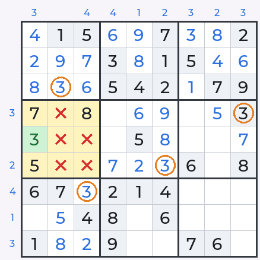

<!-- Written by tools/walkthrough.py skyscraper: edit the script, not this page. -->
# Skyscraper, step 28: the 3 in box 4

**Step 28 of 50** · [← Step 27](step-27.md) · [All steps](../skyscraper.md#the-whole-puzzle-step-by-step) · [Step 29 →](step-29.md)

Box 4 needs a 3. r4c2: row 4 has one (r4c9). r5c2: column 2 has one (r3c2). r5c3: column 3 has one (r7c3). r6c2 and r6c3: row 6 has one (r6c6). Only **r5c1** is left: **r5c1 = 3**.

**Step 28 of 50** · [← Step 27](step-27.md) · [All steps](../skyscraper.md#the-whole-puzzle-step-by-step) · [Step 29 →](step-29.md)
