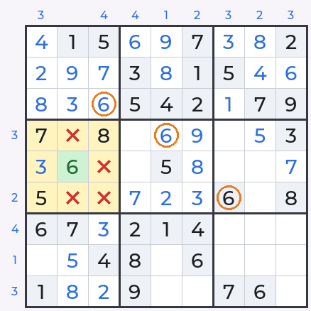

<!-- Written by tools/walkthrough.py skyscraper: edit the script, not this page. -->
# Skyscraper, step 29: the 6 in box 4

**Step 29 of 50** · [← Step 28](step-28.md) · [All steps](../skyscraper.md#the-whole-puzzle-step-by-step) · [Step 30 →](step-30.md)

Box 4 needs a 6. r4c2: row 4 has one (r4c5). r5c3: column 3 has one (r3c3). r6c2 and r6c3: row 6 has one (r6c7). Only **r5c2** is left: **r5c2 = 6**.

**Step 29 of 50** · [← Step 28](step-28.md) · [All steps](../skyscraper.md#the-whole-puzzle-step-by-step) · [Step 30 →](step-30.md)
