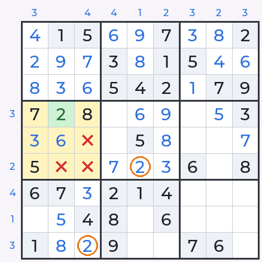

<!-- Written by tools/walkthrough.py skyscraper: edit the script, not this page. -->
# Skyscraper, step 30: the 2 in box 4

**Step 30 of 50** · [← Step 29](step-29.md) · [All steps](../skyscraper.md#the-whole-puzzle-step-by-step) · [Step 31 →](step-31.md)

Box 4 needs a 2. r5c3: column 3 has one (r9c3). r6c2 and r6c3: row 6 has one (r6c5). Only **r4c2** is left: **r4c2 = 2**.

**Step 30 of 50** · [← Step 29](step-29.md) · [All steps](../skyscraper.md#the-whole-puzzle-step-by-step) · [Step 31 →](step-31.md)
