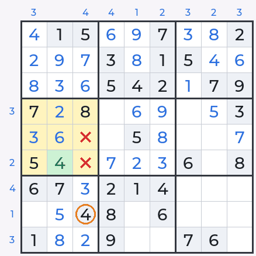

<!-- Written by tools/walkthrough.py skyscraper: edit the script, not this page. -->
# Skyscraper, step 31: the 4 in box 4

**Step 31 of 50** · [← Step 30](step-30.md) · [All steps](../skyscraper.md#the-whole-puzzle-step-by-step) · [Step 32 →](step-32.md)

Box 4 needs a 4. r5c3 and r6c3: column 3 has one (r8c3). Only **r6c2** is left: **r6c2 = 4**.

**Step 31 of 50** · [← Step 30](step-30.md) · [All steps](../skyscraper.md#the-whole-puzzle-step-by-step) · [Step 32 →](step-32.md)
