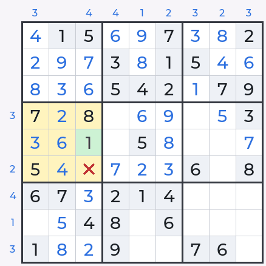

<!-- Written by tools/walkthrough.py skyscraper: edit the script, not this page. -->
# Skyscraper, step 32: the 1 in box 4

**Step 32 of 50** · [← Step 31](step-31.md) · [All steps](../skyscraper.md#the-whole-puzzle-step-by-step) · [Step 33 →](step-33.md)

Box 4 needs a 1. r6c3: seen from the left of row 6, a 1 there would leave 5 and 7 seen and the 9 still to come, more than its clue 2. Only **r5c3** is left: **r5c3 = 1**.

**Step 32 of 50** · [← Step 31](step-31.md) · [All steps](../skyscraper.md#the-whole-puzzle-step-by-step) · [Step 33 →](step-33.md)
