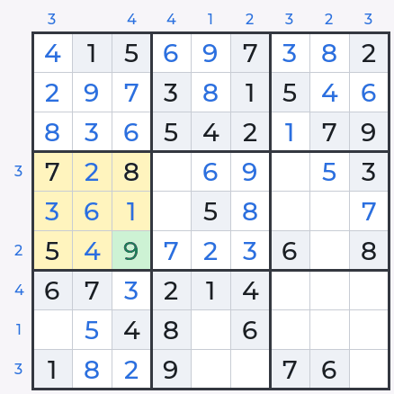

<!-- Written by tools/walkthrough.py skyscraper: edit the script, not this page. -->
# Skyscraper, step 33: the 9 in box 4

**Step 33 of 50** · [← Step 32](step-32.md) · [All steps](../skyscraper.md#the-whole-puzzle-step-by-step) · [Step 34 →](step-34.md)

Box 4 needs a 9, and r6c3 is its last empty cell: **r6c3 = 9**.

**Step 33 of 50** · [← Step 32](step-32.md) · [All steps](../skyscraper.md#the-whole-puzzle-step-by-step) · [Step 34 →](step-34.md)
