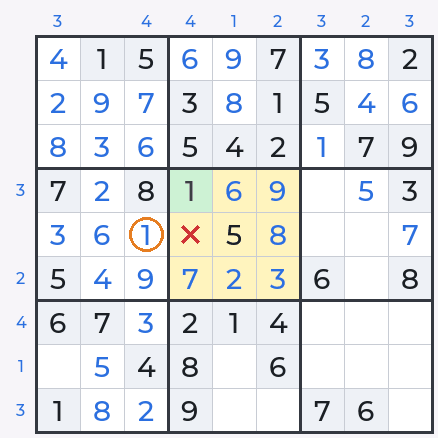

<!-- Written by tools/walkthrough.py skyscraper: edit the script, not this page. -->
# Skyscraper, step 34: the 1 in box 5

**Step 34 of 50** · [← Step 33](step-33.md) · [All steps](../skyscraper.md#the-whole-puzzle-step-by-step) · [Step 35 →](step-35.md)

Box 5 needs a 1. r5c4: row 5 has one (r5c3). Only **r4c4** is left: **r4c4 = 1**.

**Step 34 of 50** · [← Step 33](step-33.md) · [All steps](../skyscraper.md#the-whole-puzzle-step-by-step) · [Step 35 →](step-35.md)
