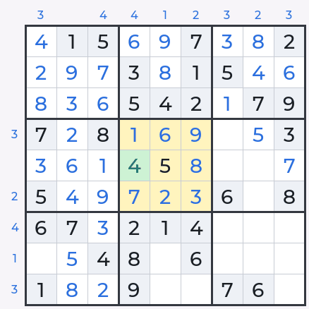

<!-- Written by tools/walkthrough.py skyscraper: edit the script, not this page. -->
# Skyscraper, step 35: the 4 in box 5

**Step 35 of 50** · [← Step 34](step-34.md) · [All steps](../skyscraper.md#the-whole-puzzle-step-by-step) · [Step 36 →](step-36.md)

Box 5 needs a 4, and r5c4 is its last empty cell: **r5c4 = 4**.

**Step 35 of 50** · [← Step 34](step-34.md) · [All steps](../skyscraper.md#the-whole-puzzle-step-by-step) · [Step 36 →](step-36.md)
