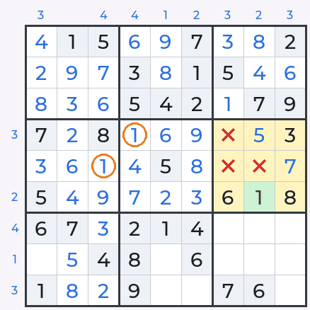

<!-- Written by tools/walkthrough.py skyscraper: edit the script, not this page. -->
# Skyscraper, step 36: the 1 in box 6

**Step 36 of 50** · [← Step 35](step-35.md) · [All steps](../skyscraper.md#the-whole-puzzle-step-by-step) · [Step 37 →](step-37.md)

Box 6 needs a 1. r4c7: row 4 has one (r4c4). r5c7 and r5c8: row 5 has one (r5c3). Only **r6c8** is left: **r6c8 = 1**.

**Step 36 of 50** · [← Step 35](step-35.md) · [All steps](../skyscraper.md#the-whole-puzzle-step-by-step) · [Step 37 →](step-37.md)
