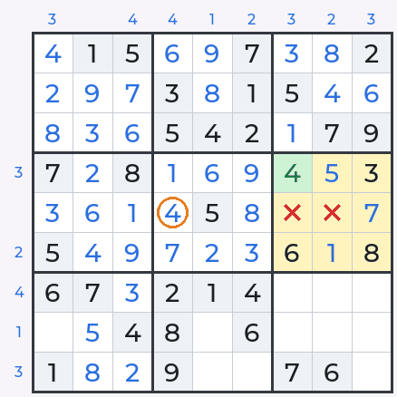

<!-- Written by tools/walkthrough.py skyscraper: edit the script, not this page. -->
# Skyscraper, step 37: the 4 in box 6

**Step 37 of 50** · [← Step 36](step-36.md) · [All steps](../skyscraper.md#the-whole-puzzle-step-by-step) · [Step 38 →](step-38.md)

Box 6 needs a 4. r5c7 and r5c8: row 5 has one (r5c4). Only **r4c7** is left: **r4c7 = 4**.

**Step 37 of 50** · [← Step 36](step-36.md) · [All steps](../skyscraper.md#the-whole-puzzle-step-by-step) · [Step 38 →](step-38.md)
