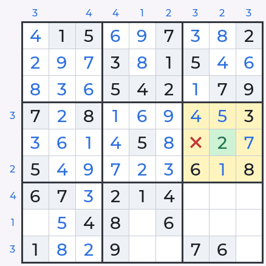

<!-- Written by tools/walkthrough.py skyscraper: edit the script, not this page. -->
# Skyscraper, step 38: the 2 in box 6

**Step 38 of 50** · [← Step 37](step-37.md) · [All steps](../skyscraper.md#the-whole-puzzle-step-by-step) · [Step 39 →](step-39.md)

Box 6 needs a 2. r5c7: seen from the top of column 7, a 2 there would leave 3, 5 and 6 seen and the 9 still to come, more than its clue 3. Only **r5c8** is left: **r5c8 = 2**.

**Step 38 of 50** · [← Step 37](step-37.md) · [All steps](../skyscraper.md#the-whole-puzzle-step-by-step) · [Step 39 →](step-39.md)
