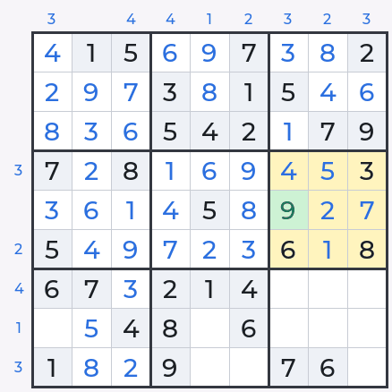

<!-- Written by tools/walkthrough.py skyscraper: edit the script, not this page. -->
# Skyscraper, step 39: the 9 in box 6

**Step 39 of 50** · [← Step 38](step-38.md) · [All steps](../skyscraper.md#the-whole-puzzle-step-by-step) · [Step 40 →](step-40.md)

Box 6 needs a 9, and r5c7 is its last empty cell: **r5c7 = 9**.

**Step 39 of 50** · [← Step 38](step-38.md) · [All steps](../skyscraper.md#the-whole-puzzle-step-by-step) · [Step 40 →](step-40.md)
