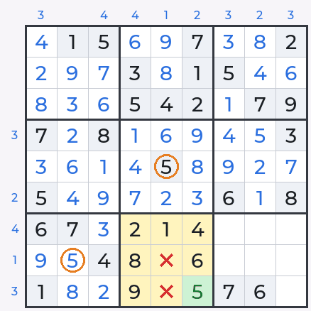

<!-- Written by tools/walkthrough.py skyscraper: edit the script, not this page. -->
# Skyscraper, step 41: the 5 in box 8

**Step 41 of 50** · [← Step 40](step-40.md) · [All steps](../skyscraper.md#the-whole-puzzle-step-by-step) · [Step 42 →](step-42.md)

Box 8 needs a 5. r8c5: row 8 has one (r8c2). r9c5: column 5 has one (r5c5). Only **r9c6** is left: **r9c6 = 5**.

**Step 41 of 50** · [← Step 40](step-40.md) · [All steps](../skyscraper.md#the-whole-puzzle-step-by-step) · [Step 42 →](step-42.md)
