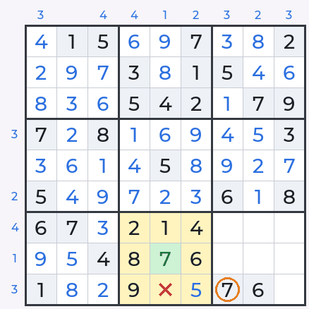

<!-- Written by tools/walkthrough.py skyscraper: edit the script, not this page. -->
# Skyscraper, step 42: the 7 in box 8

**Step 42 of 50** · [← Step 41](step-41.md) · [All steps](../skyscraper.md#the-whole-puzzle-step-by-step) · [Step 43 →](step-43.md)

Box 8 needs a 7. r9c5: row 9 has one (r9c7). Only **r8c5** is left: **r8c5 = 7**.

**Step 42 of 50** · [← Step 41](step-41.md) · [All steps](../skyscraper.md#the-whole-puzzle-step-by-step) · [Step 43 →](step-43.md)
