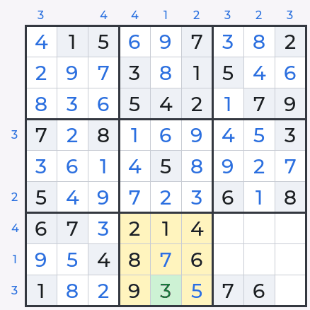

<!-- Written by tools/walkthrough.py skyscraper: edit the script, not this page. -->
# Skyscraper, step 43: the 3 in box 8

**Step 43 of 50** · [← Step 42](step-42.md) · [All steps](../skyscraper.md#the-whole-puzzle-step-by-step) · [Step 44 →](step-44.md)

Box 8 needs a 3, and r9c5 is its last empty cell: **r9c5 = 3**.

**Step 43 of 50** · [← Step 42](step-42.md) · [All steps](../skyscraper.md#the-whole-puzzle-step-by-step) · [Step 44 →](step-44.md)
