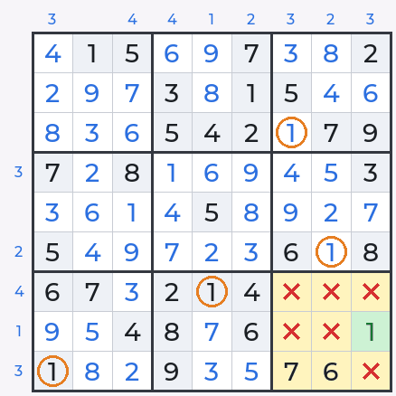

<!-- Written by tools/walkthrough.py skyscraper: edit the script, not this page. -->
# Skyscraper, step 44: the 1 in box 9

**Step 44 of 50** · [← Step 43](step-43.md) · [All steps](../skyscraper.md#the-whole-puzzle-step-by-step) · [Step 45 →](step-45.md)

Box 9 needs a 1. r7c7, r7c8 and r7c9: row 7 has one (r7c5). r8c7: column 7 has one (r3c7). r8c8: column 8 has one (r6c8). r9c9: row 9 has one (r9c1). Only **r8c9** is left: **r8c9 = 1**.

**Step 44 of 50** · [← Step 43](step-43.md) · [All steps](../skyscraper.md#the-whole-puzzle-step-by-step) · [Step 45 →](step-45.md)
