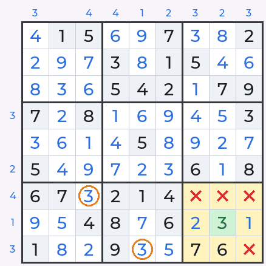

<!-- Written by tools/walkthrough.py skyscraper: edit the script, not this page. -->
# Skyscraper, step 46: the 3 in box 9

**Step 46 of 50** · [← Step 45](step-45.md) · [All steps](../skyscraper.md#the-whole-puzzle-step-by-step) · [Step 47 →](step-47.md)

Box 9 needs a 3. r7c7, r7c8 and r7c9: row 7 has one (r7c3). r9c9: row 9 has one (r9c5). Only **r8c8** is left: **r8c8 = 3**.

**Step 46 of 50** · [← Step 45](step-45.md) · [All steps](../skyscraper.md#the-whole-puzzle-step-by-step) · [Step 47 →](step-47.md)
