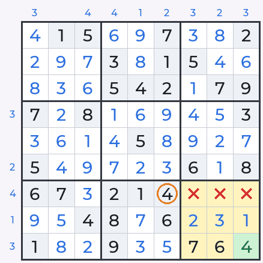

<!-- Written by tools/walkthrough.py skyscraper: edit the script, not this page. -->
# Skyscraper, step 47: the 4 in box 9

**Step 47 of 50** · [← Step 46](step-46.md) · [All steps](../skyscraper.md#the-whole-puzzle-step-by-step) · [Step 48 →](step-48.md)

Box 9 needs a 4. r7c7, r7c8 and r7c9: row 7 has one (r7c6). Only **r9c9** is left: **r9c9 = 4**.

**Step 47 of 50** · [← Step 46](step-46.md) · [All steps](../skyscraper.md#the-whole-puzzle-step-by-step) · [Step 48 →](step-48.md)
