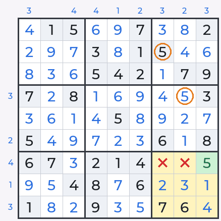

<!-- Written by tools/walkthrough.py skyscraper: edit the script, not this page. -->
# Skyscraper, step 48: the 5 in box 9

**Step 48 of 50** · [← Step 47](step-47.md) · [All steps](../skyscraper.md#the-whole-puzzle-step-by-step) · [Step 49 →](step-49.md)

Box 9 needs a 5. r7c7: column 7 has one (r2c7). r7c8: column 8 has one (r4c8). Only **r7c9** is left: **r7c9 = 5**.

**Step 48 of 50** · [← Step 47](step-47.md) · [All steps](../skyscraper.md#the-whole-puzzle-step-by-step) · [Step 49 →](step-49.md)
