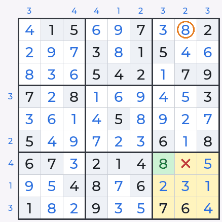

<!-- Written by tools/walkthrough.py skyscraper: edit the script, not this page. -->
# Skyscraper, step 49: the 8 in box 9

**Step 49 of 50** · [← Step 48](step-48.md) · [All steps](../skyscraper.md#the-whole-puzzle-step-by-step) · [Step 50 →](step-50.md)

Box 9 needs an 8. r7c8: column 8 has one (r1c8). Only **r7c7** is left: **r7c7 = 8**.

**Step 49 of 50** · [← Step 48](step-48.md) · [All steps](../skyscraper.md#the-whole-puzzle-step-by-step) · [Step 50 →](step-50.md)
