# Slow Thermo

[← All variants](README.md) · [Puzzles](../features-puzzles.md) · [How to play](../how-to-play.md)

## The rules

[Classic](classic.md) rules, plus **thermometers**: grey lines with a round **bulb** at one end, through cells side by side or diagonal. Along each one, the digits **rise or stay the same** from the bulb: every digit is at least the one before it. Two neighbours can only hold the same digit where the Classic rules let them, that is where they share **no row, column or box**: diagonally across the corner between two boxes. Everywhere else the digits rise, as on a [Thermo](thermo.md).

## On the board

- Each thermometer looks like Thermo's: a wide, translucent grey line with a round bulb.
- Two digits along one that fall turn red (two equal ones that may not be equal turn red anyway: they repeat in a row, column or box).
- The grader and hints narrow each thermometer cell from both ends, counting only the steps that must rise: "Along the thermometer the digits rise or stay the same from the bulb (they rise where two neighbours share a row, column or box), so row 4, column 6 can only be 1, 2, 3".
- **Puzzles → ⋮ → New puzzle → Lines → Slow Thermo**: 7 thermometers of 3 to 7 cells (Hard and Expert up to 10).

## How to solve it

- **Find the steps that can stay flat:** only a diagonal step from one box into another can repeat a digit. Every other step rises, exactly as on a Thermo.
- **Count from the ends, flat steps left out:** a cell with k rising steps before it is at least k + 1, one with k rising steps after it at most 9 − k.
- **Around a given:** a cell right before a given in the same row, column or box is smaller than it; across a box corner it may be the same.

## Worked example

**variant-examples #40**, Slow Thermo Easy (see [Classic](classic.md#worked-example-the-whole-puzzle) for how to import the examples; cells are written r*row*c*column*). The thermometers are in the screenshot; three matter here:

- r9c3 (the bulb), r9c4 (a 6), r8c4, r9c5;
- r3c5 (the bulb), r4c6, r3c6 (a 4);
- r6c2 (the bulb), r7c2 (a 2), r6c1 (a 2), r7c1 (a 9). The two 2s show the rule: r7c2 and r6c1 touch diagonally across the corner of boxes 4 and 7, so the thermometer stays flat there.

**Step 1: r8c4, after a 6.** Row 8 has 1, 2, 3 and 8; column 4 has 5, 6 and 9; that leaves 4 and 7. On its thermometer, r8c4 comes after the 6 in r9c4, in the same column, so it's above 6. **r8c4 = 7**.

**Step 2: r4c6, before a 4.** Row 4 has 2, 7 and 9; column 6 has 1, 4 and 8; that leaves 3, 5 and 6. On its thermometer, r4c6 comes before the 4 in r3c6, in the same column, so it's below 4. **r4c6 = 3**.

**Step 3: the 5 in column 2.** Column 2 needs a 5. r1c2 and r2c2 see the 5s in rows 1 and 2; r3c2, r4c2, r5c2, r7c2 and r8c2 are filled. r6c2 is the bulb before the 2 in r7c2, in the same column, so it's 1. Only **r9c2** is left: **r9c2 = 5**.

## The whole puzzle, step by step

<!-- walkthrough -->
<!-- Written by tools/walkthrough.py slow-thermo: edit the script, not this part. -->

The whole puzzle, from the start to the last cell: 53 steps, each one a single (one place left for a digit, or one digit left for a cell), taken in the order a box's single comes first, so not quite the order of the worked example above. In each picture, the unit the step looks at is tinted yellow (for a cell with one digit left: its row, column and box), the new digit is on green, the digits that rule cells out have an **orange ring**, and the empty cells they rule out a **red cross**. Givens are on grey, digits from earlier steps in blue.

#### Step 1: the 2 in box 1

Box 1 needs a 2. r1c1 and r2c1: column 1 has one (r6c1). r1c2 and r2c2: column 2 has one (r7c2). r3c1 and r3c3: row 3 has one (r3c8). Only **r1c3** is left: **r1c3 = 2**.

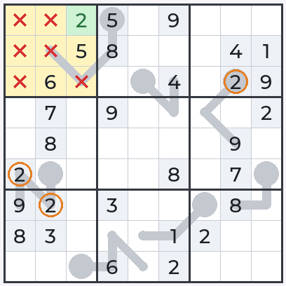

#### Step 2: the 8 in box 1

Box 1 needs an 8. r1c1 and r3c1: column 1 has one (r8c1). r1c2: column 2 has one (r5c2). r2c1 and r2c2: row 2 has one (r2c4). Only **r3c3** is left: **r3c3 = 8**.

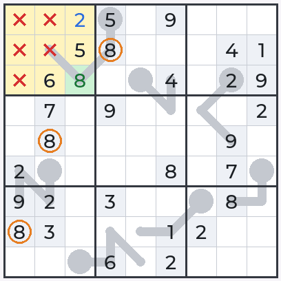

#### Step 3: the 9 in box 1

Box 1 needs a 9. r1c1 and r1c2: row 1 has one (r1c6). r2c1: column 1 has one (r7c1). r3c1: row 3 has one (r3c9). Only **r2c2** is left: **r2c2 = 9**.

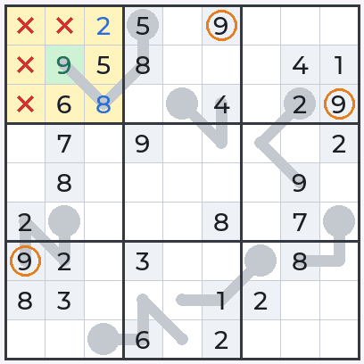

#### Step 4: the 2 in box 2

Box 2 needs a 2. r1c5: row 1 has one (r1c3). r2c6: column 6 has one (r9c6). r3c4 and r3c5: row 3 has one (r3c8). Only **r2c5** is left: **r2c5 = 2**.

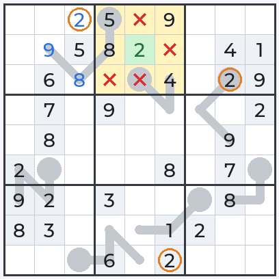

#### Step 5: the 5 in box 3

Box 3 needs a 5. r1c7, r1c8 and r1c9: row 1 has one (r1c4). r2c7: row 2 has one (r2c3). Only **r3c7** is left: **r3c7 = 5**.

#### Step 6: the 9 in box 4

Box 4 needs a 9. r4c1 and r4c3: row 4 has one (r4c4). r5c1 and r5c3: row 5 has one (r5c8). r6c2: column 2 has one (r2c2). Only **r6c3** is left: **r6c3 = 9**.

#### Step 7: the 2 in box 5

Box 5 needs a 2. r4c5 and r4c6: row 4 has one (r4c9). r5c5: column 5 has one (r2c5). r5c6: column 6 has one (r9c6). r6c4 and r6c5: row 6 has one (r6c1). Only **r5c4** is left: **r5c4 = 2**.

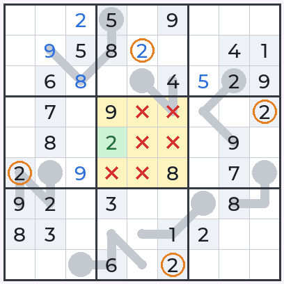

#### Step 8: the 8 in box 6

Box 6 needs an 8. r4c8: column 8 has one (r7c8). r5c7 and r5c9: row 5 has one (r5c2). r6c7 and r6c9: row 6 has one (r6c6). Only **r4c7** is left: **r4c7 = 8**.

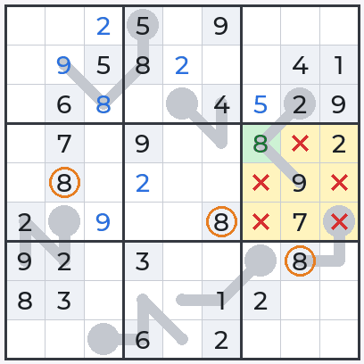

#### Step 9: the 8 in box 3

Box 3 needs an 8. r1c7: column 7 has one (r4c7). r1c8: column 8 has one (r7c8). r2c7: row 2 has one (r2c4). Only **r1c9** is left: **r1c9 = 8**.

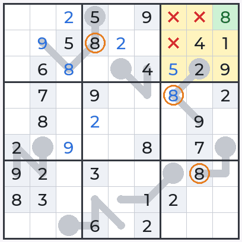

#### Step 10: the 8 in box 8

Box 8 needs an 8. r7c5 and r7c6: row 7 has one (r7c8). r8c4 and r8c5: row 8 has one (r8c1). Only **r9c5** is left: **r9c5 = 8**.

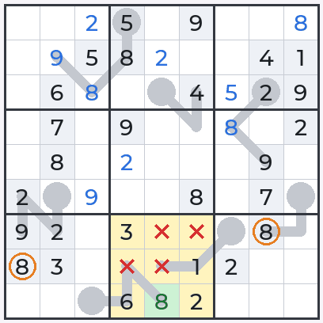

#### Step 11: the 9 in box 8

Box 8 needs a 9. r7c5 and r7c6: row 7 has one (r7c1). r8c4: column 4 has one (r4c4). Only **r8c5** is left: **r8c5 = 9**.

#### Step 12: the 4 in box 8

Box 8 needs a 4. r7c6: column 6 has one (r3c6). r8c4: it comes after the 6 in r9c4 on its thermometer, so it's above 6. Only **r7c5** is left: **r7c5 = 4**.

#### Step 13: the 4 in box 5

Box 5 needs a 4. r4c5, r5c5 and r6c5: column 5 has one (r7c5). r4c6 and r5c6: column 6 has one (r3c6). Only **r6c4** is left: **r6c4 = 4**.

#### Step 14: the 5 in box 8

Box 8 needs a 5. r8c4: column 4 has one (r1c4). Only **r7c6** is left: **r7c6 = 5**.

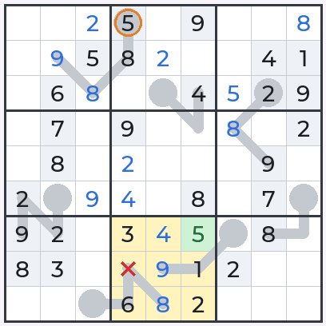

#### Step 15: the 7 in box 8

Box 8 needs a 7, and r8c4 is its last empty cell: **r8c4 = 7**.

#### Step 16: the 9 in box 9

Box 9 needs a 9. r7c7 and r7c9: row 7 has one (r7c1). r8c8 and r8c9: row 8 has one (r8c5). r9c8: column 8 has one (r5c8). r9c9: column 9 has one (r3c9). Only **r9c7** is left: **r9c7 = 9**.

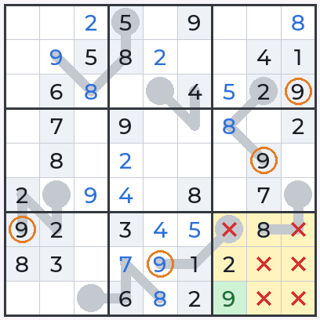

#### Step 17: the 5 in column 2

Column 2 needs a 5. r1c2: row 1 has one (r1c4). r6c2: it comes before the 2 in r7c2 on its thermometer, so it's below 2. Only **r9c2** is left: **r9c2 = 5**.

#### Step 18: the 4 in column 2

Column 2 needs a 4. r6c2: row 6 has one (r6c4). Only **r1c2** is left: **r1c2 = 4**.

#### Step 19: the 1 in column 2

Column 2 needs a 1, and r6c2 is its last empty cell: **r6c2 = 1**.

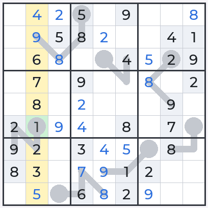

#### Step 20: the 7 in column 3

Column 3 needs a 7. r4c3: row 4 has one (r4c2). r5c3: box 4 has one (r4c2). r8c3: row 8 has one (r8c4). r9c3: its place on its thermometer keeps it between 1 and 6. Only **r7c3** is left: **r7c3 = 7**.

#### Step 21: the 6 in box 7

Box 7 needs a 6. r9c1 and r9c3: row 9 has one (r9c4). Only **r8c3** is left: **r8c3 = 6**.

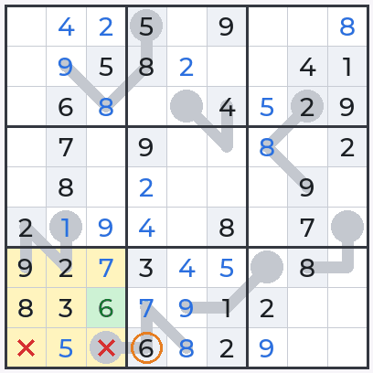

#### Step 22: the 6 in box 9

Box 9 needs a 6. r8c8 and r8c9: row 8 has one (r8c3). r9c8 and r9c9: row 9 has one (r9c4). r7c7: it comes before the 1 in r8c6 on its thermometer, so it's 1 or less. Only **r7c9** is left: **r7c9 = 6**.

#### Step 23: the 7 in box 9

Box 9 needs a 7. r7c7: row 7 has one (r7c3). r8c8 and r8c9: row 8 has one (r8c4). r9c8: column 8 has one (r6c8). Only **r9c9** is left: **r9c9 = 7**.

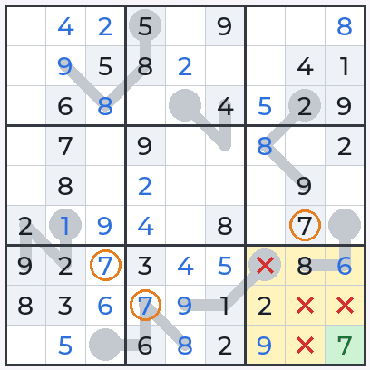

#### Step 24: the 3 in box 9

Box 9 needs a 3. r7c7: row 7 has one (r7c4). r8c8 and r8c9: row 8 has one (r8c2). Only **r9c8** is left: **r9c8 = 3**.

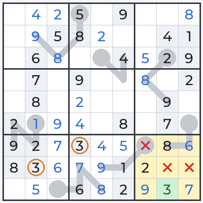

#### Step 25: the 1 in box 9

Box 9 needs a 1. r8c8 and r8c9: row 8 has one (r8c6). Only **r7c7** is left: **r7c7 = 1**.

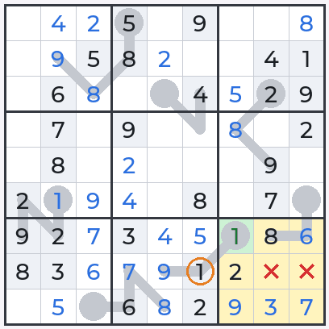

#### Step 26: the 1 in box 6

Box 6 needs a 1. r5c7: column 7 has one (r7c7). r5c9: column 9 has one (r2c9). r6c7 and r6c9: row 6 has one (r6c2). Only **r4c8** is left: **r4c8 = 1**.

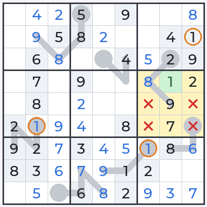

#### Step 27: the 1 in box 5

Box 5 needs a 1. r4c5 and r4c6: row 4 has one (r4c8). r5c6: column 6 has one (r8c6). r6c5: row 6 has one (r6c2). Only **r5c5** is left: **r5c5 = 1**.

#### Step 28: the 1 in box 2

Box 2 needs a 1. r1c5 and r3c5: column 5 has one (r5c5). r2c6: row 2 has one (r2c9). Only **r3c4** is left: **r3c4 = 1**.

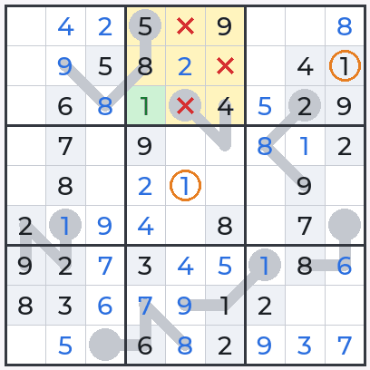

#### Step 29: the 1 in box 1

Box 1 needs a 1. r2c1: row 2 has one (r2c9). r3c1: row 3 has one (r3c4). Only **r1c1** is left: **r1c1 = 1**.

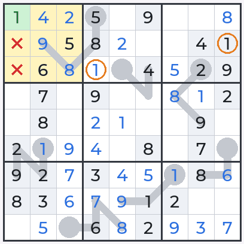

#### Step 30: the 7 in box 5

Box 5 needs a 7. r4c5 and r4c6: row 4 has one (r4c2). r6c5: row 6 has one (r6c8). Only **r5c6** is left: **r5c6 = 7**.

#### Step 31: the 1 in box 7

Box 7 needs a 1. r9c1: column 1 has one (r1c1). Only **r9c3** is left: **r9c3 = 1**.

#### Step 32: the 4 in box 7

Box 7 needs a 4, and r9c1 is its last empty cell: **r9c1 = 4**.

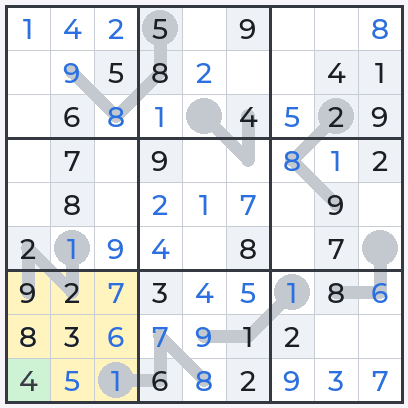

#### Step 33: the 4 in box 9

Box 9 needs a 4. r8c8: column 8 has one (r2c8). Only **r8c9** is left: **r8c9 = 4**.

#### Step 34: the 4 in box 6

Box 6 needs a 4. r5c9: column 9 has one (r8c9). r6c7 and r6c9: row 6 has one (r6c4). Only **r5c7** is left: **r5c7 = 4**.

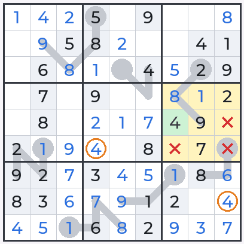

#### Step 35: the 4 in box 4

Box 4 needs a 4. r4c1: column 1 has one (r9c1). r5c1 and r5c3: row 5 has one (r5c7). Only **r4c3** is left: **r4c3 = 4**.

#### Step 36: the 6 in box 6

Box 6 needs a 6. r5c9 and r6c9: column 9 has one (r7c9). Only **r6c7** is left: **r6c7 = 6**.

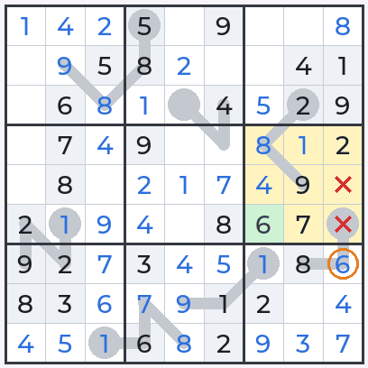

#### Step 37: the 6 in box 3

Box 3 needs a 6. r1c7 and r2c7: column 7 has one (r6c7). Only **r1c8** is left: **r1c8 = 6**.

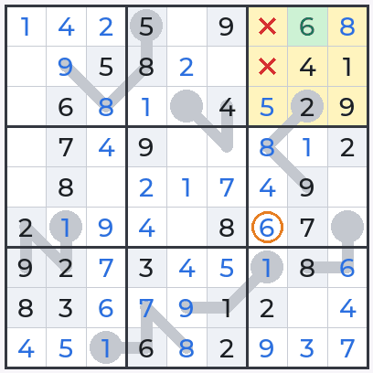

#### Step 38: the 6 in box 2

Box 2 needs a 6. r1c5: row 1 has one (r1c8). r3c5: row 3 has one (r3c2). Only **r2c6** is left: **r2c6 = 6**.

#### Step 39: the 6 in box 5

Box 5 needs a 6. r4c6: column 6 has one (r2c6). r6c5: row 6 has one (r6c7). Only **r4c5** is left: **r4c5 = 6**.

#### Step 40: the 6 in box 4

Box 4 needs a 6. r4c1: row 4 has one (r4c5). r5c3: column 3 has one (r8c3). Only **r5c1** is left: **r5c1 = 6**.

#### Step 41: the 5 in box 4

Box 4 needs a 5. r5c3: column 3 has one (r2c3). Only **r4c1** is left: **r4c1 = 5**.

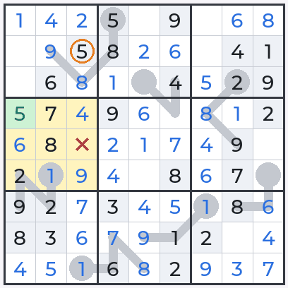

#### Step 42: the 3 in box 4

Box 4 needs a 3, and r5c3 is its last empty cell: **r5c3 = 3**.

#### Step 43: the 5 in box 5

Box 5 needs a 5. r4c6: row 4 has one (r4c1). Only **r6c5** is left: **r6c5 = 5**.

#### Step 44: the 3 in box 5

Box 5 needs a 3, and r4c6 is its last empty cell: **r4c6 = 3**.

#### Step 45: the 7 in box 2

Box 2 needs a 7. r3c5: it comes before the 3 in r4c6 on its thermometer, so it's 3 or less. Only **r1c5** is left: **r1c5 = 7**.

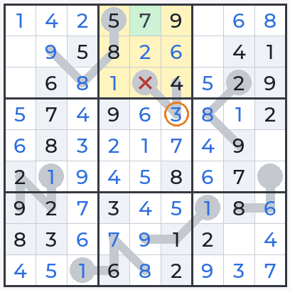

#### Step 46: the 3 in box 2

Box 2 needs a 3, and r3c5 is its last empty cell: **r3c5 = 3**.

#### Step 47: the 3 in box 1

Box 1 needs a 3. r3c1: row 3 has one (r3c5). Only **r2c1** is left: **r2c1 = 3**.

#### Step 48: the 7 in box 1

Box 1 needs a 7, and r3c1 is its last empty cell: **r3c1 = 7**.

#### Step 49: the 3 in box 3

Box 3 needs a 3. r2c7: row 2 has one (r2c1). Only **r1c7** is left: **r1c7 = 3**.

#### Step 50: the 7 in box 3

Box 3 needs a 7, and r2c7 is its last empty cell: **r2c7 = 7**.

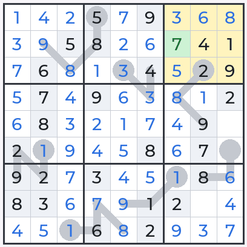

#### Step 51: the 3 in box 6

Box 6 needs a 3. r5c9: row 5 has one (r5c3). Only **r6c9** is left: **r6c9 = 3**.

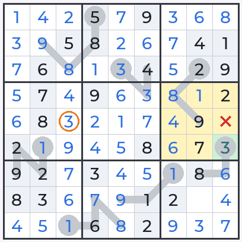

#### Step 52: the 5 in box 6

Box 6 needs a 5, and r5c9 is its last empty cell: **r5c9 = 5**.

#### Step 53: the 5 in box 9

Box 9 needs a 5, and r8c8 is its last empty cell: **r8c8 = 5**.

Solved.

<!-- /walkthrough -->
