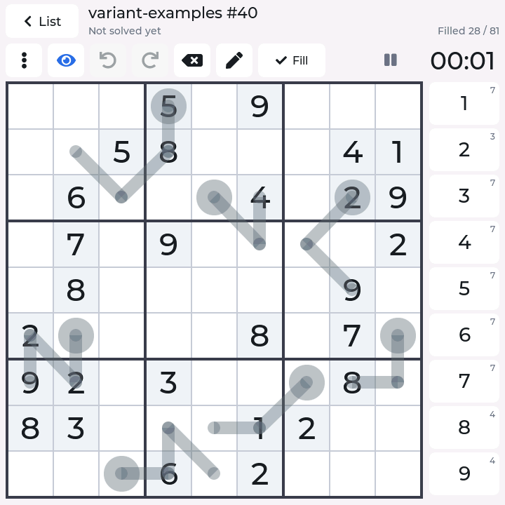
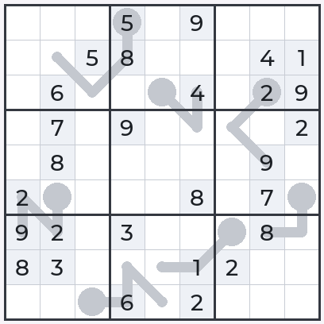

# Slow Thermo

[← All variants](README.md) · [Puzzles](../features-puzzles.md) · [How to play](../how-to-play.md)

## The rules

[Classic](classic.md) rules, plus **thermometers**: grey lines with a round **bulb** at one end, through cells side by side or diagonal. Along each one, the digits **rise or stay the same** from the bulb: every digit is at least the one before it. Two neighbours can only hold the same digit where the Classic rules let them, that is where they share **no row, column or box**: diagonally across the corner between two boxes. Everywhere else the digits rise, as on a [Thermo](thermo.md).

## On the board

- Each thermometer looks like Thermo's: a wide, translucent grey line with a round bulb.
- Two digits along one that fall turn red (two equal ones that may not be equal turn red anyway: they repeat in a row, column or box).
- The grader and hints narrow each thermometer cell from both ends, counting only the steps that must rise: "Along the thermometer the digits rise or stay the same from the bulb (they rise where two neighbours share a row, column or box), so row 4, column 6 can only be 1, 2, 3".
- **Puzzles → ⋮ → New puzzle → Lines → Slow Thermo**: 7 thermometers of 3 to 7 cells (Hard and Expert up to 10).

## How to solve it

- **Find the steps that can stay flat:** only a diagonal step from one box into another can repeat a digit. Every other step rises, exactly as on a Thermo.
- **Count from the ends, flat steps left out:** a cell with k rising steps before it is at least k + 1, one with k rising steps after it at most 9 − k.
- **Around a given:** a cell right before a given in the same row, column or box is smaller than it; across a box corner it may be the same.

## Worked example

**variant-examples #40**, Slow Thermo Easy (see [Classic](classic.md#worked-example-the-whole-puzzle) for how to import the examples; cells are written r*row*c*column*). The thermometers are in the screenshot; three matter here:

- r9c3 (the bulb), r9c4 (a 6), r8c4, r9c5;
- r3c5 (the bulb), r4c6, r3c6 (a 4);
- r6c2 (the bulb), r7c2 (a 2), r6c1 (a 2), r7c1 (a 9). The two 2s show the rule: r7c2 and r6c1 touch diagonally across the corner of boxes 4 and 7, so the thermometer stays flat there.

**Step 1: r8c4, after a 6.** Row 8 has 1, 2, 3 and 8; column 4 has 5, 6 and 9; that leaves 4 and 7. On its thermometer, r8c4 comes after the 6 in r9c4, in the same column, so it's above 6. **r8c4 = 7**.

**Step 2: r4c6, before a 4.** Row 4 has 2, 7 and 9; column 6 has 1, 4 and 8; that leaves 3, 5 and 6. On its thermometer, r4c6 comes before the 4 in r3c6, in the same column, so it's below 4. **r4c6 = 3**.

**Step 3: the 5 in column 2.** Column 2 needs a 5. r1c2 and r2c2 see the 5s in rows 1 and 2; r3c2, r4c2, r5c2, r7c2 and r8c2 are filled. r6c2 is the bulb before the 2 in r7c2, in the same column, so it's 1. Only **r9c2** is left: **r9c2 = 5**.

## The whole puzzle, step by step

<!-- walkthrough -->
<!-- Written by tools/walkthrough.py slow-thermo: edit the script, not this part. -->

The whole puzzle, from the start to the last cell: 53 steps, each one a single (one place left for a digit, or one digit left for a cell), taken in the order a box's single comes first, so not quite the order of the worked example above. Each step has a page of its own, with **Previous** and **Next**: pick one from the list below. In each picture, the unit the step looks at is tinted yellow (for a cell with one digit left: its row, column and box), the new digit is on green, the digits that rule cells out have an **orange ring**, and the empty cells they rule out a **red cross**. Givens are on grey, digits from earlier steps in blue.

1. [the 2 in box 1](slow-thermo/step-01.md)
2. [the 8 in box 1](slow-thermo/step-02.md)
3. [the 9 in box 1](slow-thermo/step-03.md)
4. [the 2 in box 2](slow-thermo/step-04.md)
5. [the 5 in box 3](slow-thermo/step-05.md)
6. [the 9 in box 4](slow-thermo/step-06.md)
7. [the 2 in box 5](slow-thermo/step-07.md)
8. [the 8 in box 6](slow-thermo/step-08.md)
9. [the 8 in box 3](slow-thermo/step-09.md)
10. [the 8 in box 8](slow-thermo/step-10.md)
11. [the 9 in box 8](slow-thermo/step-11.md)
12. [the 4 in box 8](slow-thermo/step-12.md)
13. [the 4 in box 5](slow-thermo/step-13.md)
14. [the 5 in box 8](slow-thermo/step-14.md)
15. [the 7 in box 8](slow-thermo/step-15.md)
16. [the 9 in box 9](slow-thermo/step-16.md)
17. [the 5 in column 2](slow-thermo/step-17.md)
18. [the 4 in column 2](slow-thermo/step-18.md)
19. [the 1 in column 2](slow-thermo/step-19.md)
20. [the 7 in column 3](slow-thermo/step-20.md)
21. [the 6 in box 7](slow-thermo/step-21.md)
22. [the 6 in box 9](slow-thermo/step-22.md)
23. [the 7 in box 9](slow-thermo/step-23.md)
24. [the 3 in box 9](slow-thermo/step-24.md)
25. [the 1 in box 9](slow-thermo/step-25.md)
26. [the 1 in box 6](slow-thermo/step-26.md)
27. [the 1 in box 5](slow-thermo/step-27.md)
28. [the 1 in box 2](slow-thermo/step-28.md)
29. [the 1 in box 1](slow-thermo/step-29.md)
30. [the 7 in box 5](slow-thermo/step-30.md)
31. [the 1 in box 7](slow-thermo/step-31.md)
32. [the 4 in box 7](slow-thermo/step-32.md)
33. [the 4 in box 9](slow-thermo/step-33.md)
34. [the 4 in box 6](slow-thermo/step-34.md)
35. [the 4 in box 4](slow-thermo/step-35.md)
36. [the 6 in box 6](slow-thermo/step-36.md)
37. [the 6 in box 3](slow-thermo/step-37.md)
38. [the 6 in box 2](slow-thermo/step-38.md)
39. [the 6 in box 5](slow-thermo/step-39.md)
40. [the 6 in box 4](slow-thermo/step-40.md)
41. [the 5 in box 4](slow-thermo/step-41.md)
42. [the 3 in box 4](slow-thermo/step-42.md)
43. [the 5 in box 5](slow-thermo/step-43.md)
44. [the 3 in box 5](slow-thermo/step-44.md)
45. [the 7 in box 2](slow-thermo/step-45.md)
46. [the 3 in box 2](slow-thermo/step-46.md)
47. [the 3 in box 1](slow-thermo/step-47.md)
48. [the 7 in box 1](slow-thermo/step-48.md)
49. [the 3 in box 3](slow-thermo/step-49.md)
50. [the 7 in box 3](slow-thermo/step-50.md)
51. [the 3 in box 6](slow-thermo/step-51.md)
52. [the 5 in box 6](slow-thermo/step-52.md)
53. [the 5 in box 9](slow-thermo/step-53.md)

Solved.

<!-- /walkthrough -->
