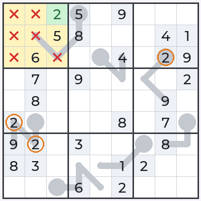

<!-- Written by tools/walkthrough.py slow-thermo: edit the script, not this page. -->
# Slow Thermo, step 1: the 2 in box 1

**Step 1 of 53** · [← The start](../slow-thermo.md#the-whole-puzzle-step-by-step) · [All steps](../slow-thermo.md#the-whole-puzzle-step-by-step) · [Step 2 →](step-02.md)

Box 1 needs a 2. r1c1 and r2c1: column 1 has one (r6c1). r1c2 and r2c2: column 2 has one (r7c2). r3c1 and r3c3: row 3 has one (r3c8). Only **r1c3** is left: **r1c3 = 2**.

**Step 1 of 53** · [← The start](../slow-thermo.md#the-whole-puzzle-step-by-step) · [All steps](../slow-thermo.md#the-whole-puzzle-step-by-step) · [Step 2 →](step-02.md)
