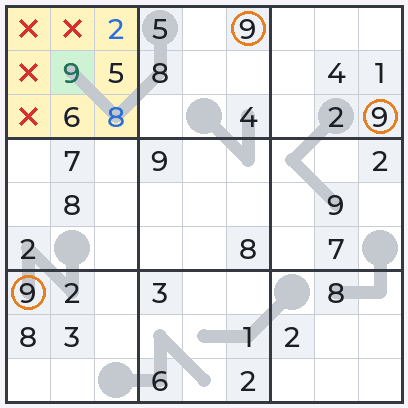

<!-- Written by tools/walkthrough.py slow-thermo: edit the script, not this page. -->
# Slow Thermo, step 3: the 9 in box 1

**Step 3 of 53** · [← Step 2](step-02.md) · [All steps](../slow-thermo.md#the-whole-puzzle-step-by-step) · [Step 4 →](step-04.md)

Box 1 needs a 9. r1c1 and r1c2: row 1 has one (r1c6). r2c1: column 1 has one (r7c1). r3c1: row 3 has one (r3c9). Only **r2c2** is left: **r2c2 = 9**.

**Step 3 of 53** · [← Step 2](step-02.md) · [All steps](../slow-thermo.md#the-whole-puzzle-step-by-step) · [Step 4 →](step-04.md)
