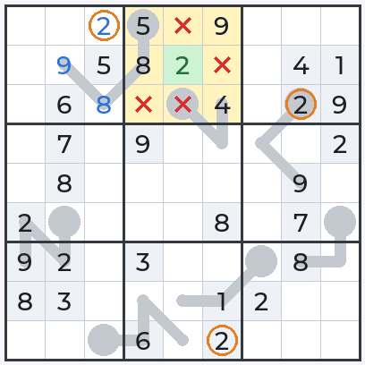

<!-- Written by tools/walkthrough.py slow-thermo: edit the script, not this page. -->
# Slow Thermo, step 4: the 2 in box 2

**Step 4 of 53** · [← Step 3](step-03.md) · [All steps](../slow-thermo.md#the-whole-puzzle-step-by-step) · [Step 5 →](step-05.md)

Box 2 needs a 2. r1c5: row 1 has one (r1c3). r2c6: column 6 has one (r9c6). r3c4 and r3c5: row 3 has one (r3c8). Only **r2c5** is left: **r2c5 = 2**.

**Step 4 of 53** · [← Step 3](step-03.md) · [All steps](../slow-thermo.md#the-whole-puzzle-step-by-step) · [Step 5 →](step-05.md)
