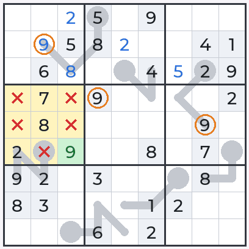

<!-- Written by tools/walkthrough.py slow-thermo: edit the script, not this page. -->
# Slow Thermo, step 6: the 9 in box 4

**Step 6 of 53** · [← Step 5](step-05.md) · [All steps](../slow-thermo.md#the-whole-puzzle-step-by-step) · [Step 7 →](step-07.md)

Box 4 needs a 9. r4c1 and r4c3: row 4 has one (r4c4). r5c1 and r5c3: row 5 has one (r5c8). r6c2: column 2 has one (r2c2). Only **r6c3** is left: **r6c3 = 9**.

**Step 6 of 53** · [← Step 5](step-05.md) · [All steps](../slow-thermo.md#the-whole-puzzle-step-by-step) · [Step 7 →](step-07.md)
