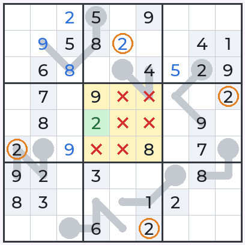

<!-- Written by tools/walkthrough.py slow-thermo: edit the script, not this page. -->
# Slow Thermo, step 7: the 2 in box 5

**Step 7 of 53** · [← Step 6](step-06.md) · [All steps](../slow-thermo.md#the-whole-puzzle-step-by-step) · [Step 8 →](step-08.md)

Box 5 needs a 2. r4c5 and r4c6: row 4 has one (r4c9). r5c5: column 5 has one (r2c5). r5c6: column 6 has one (r9c6). r6c4 and r6c5: row 6 has one (r6c1). Only **r5c4** is left: **r5c4 = 2**.

**Step 7 of 53** · [← Step 6](step-06.md) · [All steps](../slow-thermo.md#the-whole-puzzle-step-by-step) · [Step 8 →](step-08.md)
