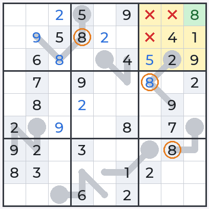

<!-- Written by tools/walkthrough.py slow-thermo: edit the script, not this page. -->
# Slow Thermo, step 9: the 8 in box 3

**Step 9 of 53** · [← Step 8](step-08.md) · [All steps](../slow-thermo.md#the-whole-puzzle-step-by-step) · [Step 10 →](step-10.md)

Box 3 needs an 8. r1c7: column 7 has one (r4c7). r1c8: column 8 has one (r7c8). r2c7: row 2 has one (r2c4). Only **r1c9** is left: **r1c9 = 8**.

**Step 9 of 53** · [← Step 8](step-08.md) · [All steps](../slow-thermo.md#the-whole-puzzle-step-by-step) · [Step 10 →](step-10.md)
