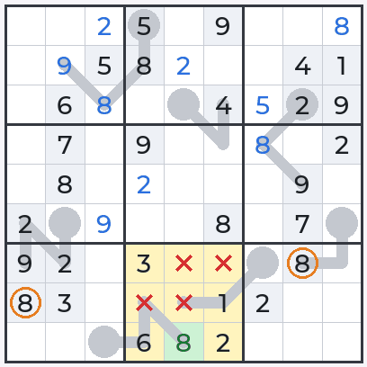

<!-- Written by tools/walkthrough.py slow-thermo: edit the script, not this page. -->
# Slow Thermo, step 10: the 8 in box 8

**Step 10 of 53** · [← Step 9](step-09.md) · [All steps](../slow-thermo.md#the-whole-puzzle-step-by-step) · [Step 11 →](step-11.md)

Box 8 needs an 8. r7c5 and r7c6: row 7 has one (r7c8). r8c4 and r8c5: row 8 has one (r8c1). Only **r9c5** is left: **r9c5 = 8**.

**Step 10 of 53** · [← Step 9](step-09.md) · [All steps](../slow-thermo.md#the-whole-puzzle-step-by-step) · [Step 11 →](step-11.md)
