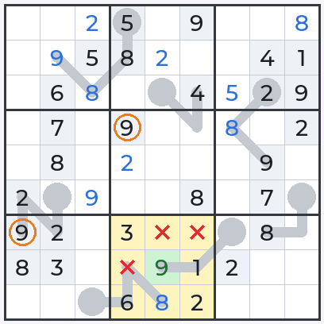

<!-- Written by tools/walkthrough.py slow-thermo: edit the script, not this page. -->
# Slow Thermo, step 11: the 9 in box 8

**Step 11 of 53** · [← Step 10](step-10.md) · [All steps](../slow-thermo.md#the-whole-puzzle-step-by-step) · [Step 12 →](step-12.md)

Box 8 needs a 9. r7c5 and r7c6: row 7 has one (r7c1). r8c4: column 4 has one (r4c4). Only **r8c5** is left: **r8c5 = 9**.

**Step 11 of 53** · [← Step 10](step-10.md) · [All steps](../slow-thermo.md#the-whole-puzzle-step-by-step) · [Step 12 →](step-12.md)
