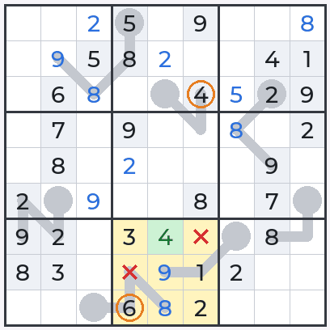

<!-- Written by tools/walkthrough.py slow-thermo: edit the script, not this page. -->
# Slow Thermo, step 12: the 4 in box 8

**Step 12 of 53** · [← Step 11](step-11.md) · [All steps](../slow-thermo.md#the-whole-puzzle-step-by-step) · [Step 13 →](step-13.md)

Box 8 needs a 4. r7c6: column 6 has one (r3c6). r8c4: it comes after the 6 in r9c4 on its thermometer, so it's above 6. Only **r7c5** is left: **r7c5 = 4**.

**Step 12 of 53** · [← Step 11](step-11.md) · [All steps](../slow-thermo.md#the-whole-puzzle-step-by-step) · [Step 13 →](step-13.md)
