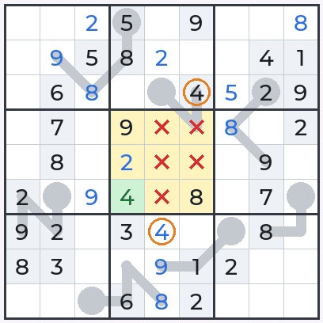

<!-- Written by tools/walkthrough.py slow-thermo: edit the script, not this page. -->
# Slow Thermo, step 13: the 4 in box 5

**Step 13 of 53** · [← Step 12](step-12.md) · [All steps](../slow-thermo.md#the-whole-puzzle-step-by-step) · [Step 14 →](step-14.md)

Box 5 needs a 4. r4c5, r5c5 and r6c5: column 5 has one (r7c5). r4c6 and r5c6: column 6 has one (r3c6). Only **r6c4** is left: **r6c4 = 4**.

**Step 13 of 53** · [← Step 12](step-12.md) · [All steps](../slow-thermo.md#the-whole-puzzle-step-by-step) · [Step 14 →](step-14.md)
