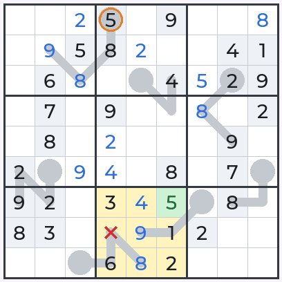

<!-- Written by tools/walkthrough.py slow-thermo: edit the script, not this page. -->
# Slow Thermo, step 14: the 5 in box 8

**Step 14 of 53** · [← Step 13](step-13.md) · [All steps](../slow-thermo.md#the-whole-puzzle-step-by-step) · [Step 15 →](step-15.md)

Box 8 needs a 5. r8c4: column 4 has one (r1c4). Only **r7c6** is left: **r7c6 = 5**.

**Step 14 of 53** · [← Step 13](step-13.md) · [All steps](../slow-thermo.md#the-whole-puzzle-step-by-step) · [Step 15 →](step-15.md)
