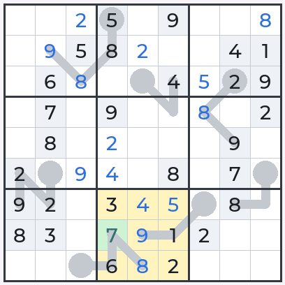

<!-- Written by tools/walkthrough.py slow-thermo: edit the script, not this page. -->
# Slow Thermo, step 15: the 7 in box 8

**Step 15 of 53** · [← Step 14](step-14.md) · [All steps](../slow-thermo.md#the-whole-puzzle-step-by-step) · [Step 16 →](step-16.md)

Box 8 needs a 7, and r8c4 is its last empty cell: **r8c4 = 7**.

**Step 15 of 53** · [← Step 14](step-14.md) · [All steps](../slow-thermo.md#the-whole-puzzle-step-by-step) · [Step 16 →](step-16.md)
