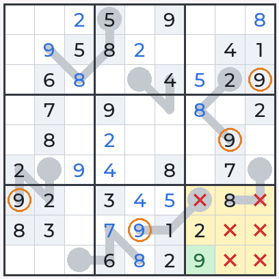

<!-- Written by tools/walkthrough.py slow-thermo: edit the script, not this page. -->
# Slow Thermo, step 16: the 9 in box 9

**Step 16 of 53** · [← Step 15](step-15.md) · [All steps](../slow-thermo.md#the-whole-puzzle-step-by-step) · [Step 17 →](step-17.md)

Box 9 needs a 9. r7c7 and r7c9: row 7 has one (r7c1). r8c8 and r8c9: row 8 has one (r8c5). r9c8: column 8 has one (r5c8). r9c9: column 9 has one (r3c9). Only **r9c7** is left: **r9c7 = 9**.

**Step 16 of 53** · [← Step 15](step-15.md) · [All steps](../slow-thermo.md#the-whole-puzzle-step-by-step) · [Step 17 →](step-17.md)
