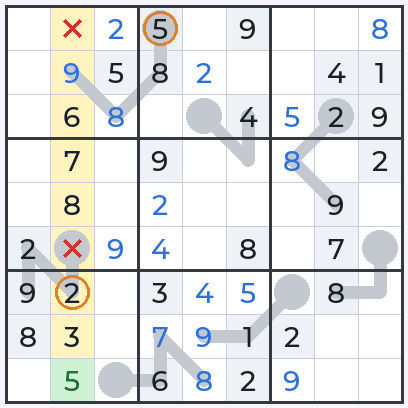

<!-- Written by tools/walkthrough.py slow-thermo: edit the script, not this page. -->
# Slow Thermo, step 17: the 5 in column 2

**Step 17 of 53** · [← Step 16](step-16.md) · [All steps](../slow-thermo.md#the-whole-puzzle-step-by-step) · [Step 18 →](step-18.md)

Column 2 needs a 5. r1c2: row 1 has one (r1c4). r6c2: it comes before the 2 in r7c2 on its thermometer, so it's below 2. Only **r9c2** is left: **r9c2 = 5**.

**Step 17 of 53** · [← Step 16](step-16.md) · [All steps](../slow-thermo.md#the-whole-puzzle-step-by-step) · [Step 18 →](step-18.md)
