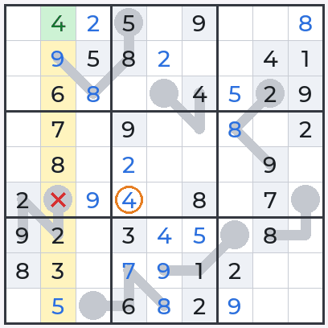

<!-- Written by tools/walkthrough.py slow-thermo: edit the script, not this page. -->
# Slow Thermo, step 18: the 4 in column 2

**Step 18 of 53** · [← Step 17](step-17.md) · [All steps](../slow-thermo.md#the-whole-puzzle-step-by-step) · [Step 19 →](step-19.md)

Column 2 needs a 4. r6c2: row 6 has one (r6c4). Only **r1c2** is left: **r1c2 = 4**.

**Step 18 of 53** · [← Step 17](step-17.md) · [All steps](../slow-thermo.md#the-whole-puzzle-step-by-step) · [Step 19 →](step-19.md)
