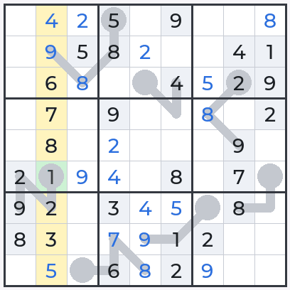

<!-- Written by tools/walkthrough.py slow-thermo: edit the script, not this page. -->
# Slow Thermo, step 19: the 1 in column 2

**Step 19 of 53** · [← Step 18](step-18.md) · [All steps](../slow-thermo.md#the-whole-puzzle-step-by-step) · [Step 20 →](step-20.md)

Column 2 needs a 1, and r6c2 is its last empty cell: **r6c2 = 1**.

**Step 19 of 53** · [← Step 18](step-18.md) · [All steps](../slow-thermo.md#the-whole-puzzle-step-by-step) · [Step 20 →](step-20.md)
