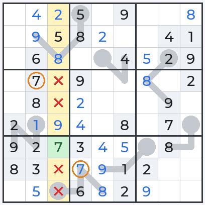

<!-- Written by tools/walkthrough.py slow-thermo: edit the script, not this page. -->
# Slow Thermo, step 20: the 7 in column 3

**Step 20 of 53** · [← Step 19](step-19.md) · [All steps](../slow-thermo.md#the-whole-puzzle-step-by-step) · [Step 21 →](step-21.md)

Column 3 needs a 7. r4c3: row 4 has one (r4c2). r5c3: box 4 has one (r4c2). r8c3: row 8 has one (r8c4). r9c3: its place on its thermometer keeps it between 1 and 6. Only **r7c3** is left: **r7c3 = 7**.

**Step 20 of 53** · [← Step 19](step-19.md) · [All steps](../slow-thermo.md#the-whole-puzzle-step-by-step) · [Step 21 →](step-21.md)
