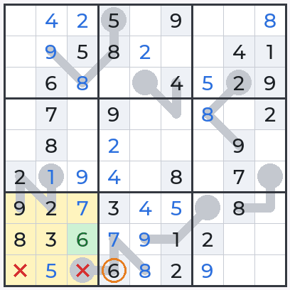

<!-- Written by tools/walkthrough.py slow-thermo: edit the script, not this page. -->
# Slow Thermo, step 21: the 6 in box 7

**Step 21 of 53** · [← Step 20](step-20.md) · [All steps](../slow-thermo.md#the-whole-puzzle-step-by-step) · [Step 22 →](step-22.md)

Box 7 needs a 6. r9c1 and r9c3: row 9 has one (r9c4). Only **r8c3** is left: **r8c3 = 6**.

**Step 21 of 53** · [← Step 20](step-20.md) · [All steps](../slow-thermo.md#the-whole-puzzle-step-by-step) · [Step 22 →](step-22.md)
