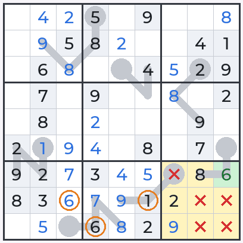

<!-- Written by tools/walkthrough.py slow-thermo: edit the script, not this page. -->
# Slow Thermo, step 22: the 6 in box 9

**Step 22 of 53** · [← Step 21](step-21.md) · [All steps](../slow-thermo.md#the-whole-puzzle-step-by-step) · [Step 23 →](step-23.md)

Box 9 needs a 6. r8c8 and r8c9: row 8 has one (r8c3). r9c8 and r9c9: row 9 has one (r9c4). r7c7: it comes before the 1 in r8c6 on its thermometer, so it's 1 or less. Only **r7c9** is left: **r7c9 = 6**.

**Step 22 of 53** · [← Step 21](step-21.md) · [All steps](../slow-thermo.md#the-whole-puzzle-step-by-step) · [Step 23 →](step-23.md)
