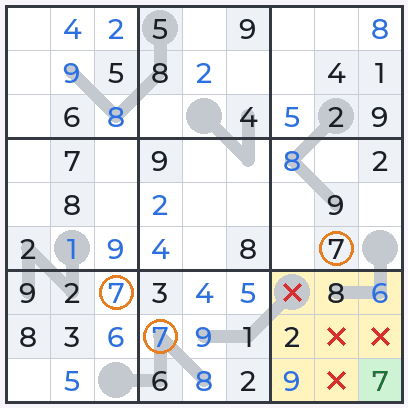

<!-- Written by tools/walkthrough.py slow-thermo: edit the script, not this page. -->
# Slow Thermo, step 23: the 7 in box 9

**Step 23 of 53** · [← Step 22](step-22.md) · [All steps](../slow-thermo.md#the-whole-puzzle-step-by-step) · [Step 24 →](step-24.md)

Box 9 needs a 7. r7c7: row 7 has one (r7c3). r8c8 and r8c9: row 8 has one (r8c4). r9c8: column 8 has one (r6c8). Only **r9c9** is left: **r9c9 = 7**.

**Step 23 of 53** · [← Step 22](step-22.md) · [All steps](../slow-thermo.md#the-whole-puzzle-step-by-step) · [Step 24 →](step-24.md)
