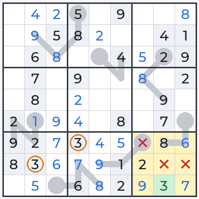

<!-- Written by tools/walkthrough.py slow-thermo: edit the script, not this page. -->
# Slow Thermo, step 24: the 3 in box 9

**Step 24 of 53** · [← Step 23](step-23.md) · [All steps](../slow-thermo.md#the-whole-puzzle-step-by-step) · [Step 25 →](step-25.md)

Box 9 needs a 3. r7c7: row 7 has one (r7c4). r8c8 and r8c9: row 8 has one (r8c2). Only **r9c8** is left: **r9c8 = 3**.

**Step 24 of 53** · [← Step 23](step-23.md) · [All steps](../slow-thermo.md#the-whole-puzzle-step-by-step) · [Step 25 →](step-25.md)
