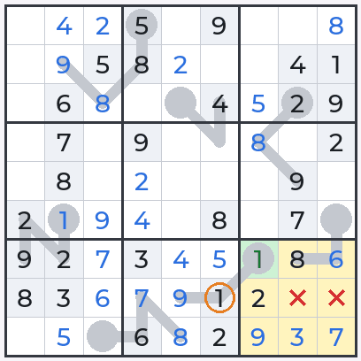

<!-- Written by tools/walkthrough.py slow-thermo: edit the script, not this page. -->
# Slow Thermo, step 25: the 1 in box 9

**Step 25 of 53** · [← Step 24](step-24.md) · [All steps](../slow-thermo.md#the-whole-puzzle-step-by-step) · [Step 26 →](step-26.md)

Box 9 needs a 1. r8c8 and r8c9: row 8 has one (r8c6). Only **r7c7** is left: **r7c7 = 1**.

**Step 25 of 53** · [← Step 24](step-24.md) · [All steps](../slow-thermo.md#the-whole-puzzle-step-by-step) · [Step 26 →](step-26.md)
