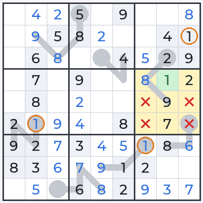

<!-- Written by tools/walkthrough.py slow-thermo: edit the script, not this page. -->
# Slow Thermo, step 26: the 1 in box 6

**Step 26 of 53** · [← Step 25](step-25.md) · [All steps](../slow-thermo.md#the-whole-puzzle-step-by-step) · [Step 27 →](step-27.md)

Box 6 needs a 1. r5c7: column 7 has one (r7c7). r5c9: column 9 has one (r2c9). r6c7 and r6c9: row 6 has one (r6c2). Only **r4c8** is left: **r4c8 = 1**.

**Step 26 of 53** · [← Step 25](step-25.md) · [All steps](../slow-thermo.md#the-whole-puzzle-step-by-step) · [Step 27 →](step-27.md)
