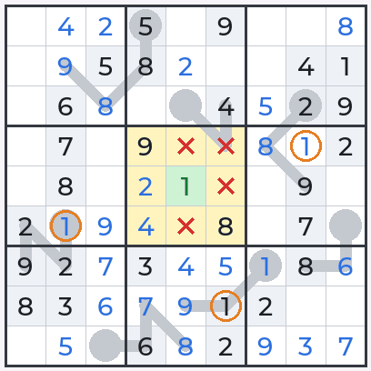

<!-- Written by tools/walkthrough.py slow-thermo: edit the script, not this page. -->
# Slow Thermo, step 27: the 1 in box 5

**Step 27 of 53** · [← Step 26](step-26.md) · [All steps](../slow-thermo.md#the-whole-puzzle-step-by-step) · [Step 28 →](step-28.md)

Box 5 needs a 1. r4c5 and r4c6: row 4 has one (r4c8). r5c6: column 6 has one (r8c6). r6c5: row 6 has one (r6c2). Only **r5c5** is left: **r5c5 = 1**.

**Step 27 of 53** · [← Step 26](step-26.md) · [All steps](../slow-thermo.md#the-whole-puzzle-step-by-step) · [Step 28 →](step-28.md)
