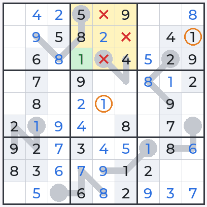

<!-- Written by tools/walkthrough.py slow-thermo: edit the script, not this page. -->
# Slow Thermo, step 28: the 1 in box 2

**Step 28 of 53** · [← Step 27](step-27.md) · [All steps](../slow-thermo.md#the-whole-puzzle-step-by-step) · [Step 29 →](step-29.md)

Box 2 needs a 1. r1c5 and r3c5: column 5 has one (r5c5). r2c6: row 2 has one (r2c9). Only **r3c4** is left: **r3c4 = 1**.

**Step 28 of 53** · [← Step 27](step-27.md) · [All steps](../slow-thermo.md#the-whole-puzzle-step-by-step) · [Step 29 →](step-29.md)
