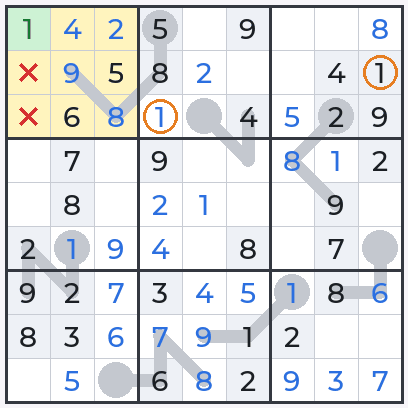

<!-- Written by tools/walkthrough.py slow-thermo: edit the script, not this page. -->
# Slow Thermo, step 29: the 1 in box 1

**Step 29 of 53** · [← Step 28](step-28.md) · [All steps](../slow-thermo.md#the-whole-puzzle-step-by-step) · [Step 30 →](step-30.md)

Box 1 needs a 1. r2c1: row 2 has one (r2c9). r3c1: row 3 has one (r3c4). Only **r1c1** is left: **r1c1 = 1**.

**Step 29 of 53** · [← Step 28](step-28.md) · [All steps](../slow-thermo.md#the-whole-puzzle-step-by-step) · [Step 30 →](step-30.md)
