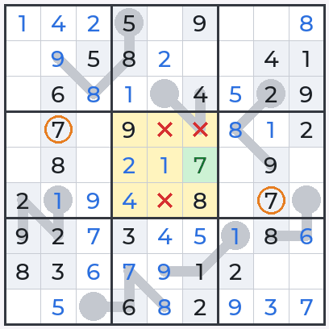

<!-- Written by tools/walkthrough.py slow-thermo: edit the script, not this page. -->
# Slow Thermo, step 30: the 7 in box 5

**Step 30 of 53** · [← Step 29](step-29.md) · [All steps](../slow-thermo.md#the-whole-puzzle-step-by-step) · [Step 31 →](step-31.md)

Box 5 needs a 7. r4c5 and r4c6: row 4 has one (r4c2). r6c5: row 6 has one (r6c8). Only **r5c6** is left: **r5c6 = 7**.

**Step 30 of 53** · [← Step 29](step-29.md) · [All steps](../slow-thermo.md#the-whole-puzzle-step-by-step) · [Step 31 →](step-31.md)
