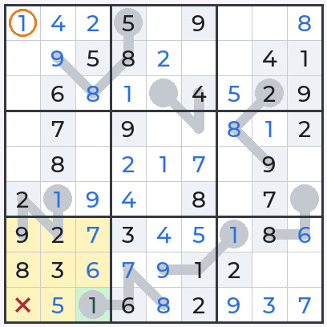

<!-- Written by tools/walkthrough.py slow-thermo: edit the script, not this page. -->
# Slow Thermo, step 31: the 1 in box 7

**Step 31 of 53** · [← Step 30](step-30.md) · [All steps](../slow-thermo.md#the-whole-puzzle-step-by-step) · [Step 32 →](step-32.md)

Box 7 needs a 1. r9c1: column 1 has one (r1c1). Only **r9c3** is left: **r9c3 = 1**.

**Step 31 of 53** · [← Step 30](step-30.md) · [All steps](../slow-thermo.md#the-whole-puzzle-step-by-step) · [Step 32 →](step-32.md)
